<div align="center">

# Hand in work that looks like you meant it

[](https://github.com/Sillvs/edhec-project-template/actions/workflows/build.yml)
[](LICENSE)

**Slides, a paper and a one-page leave-behind in the EDHEC design.**
Write plain HTML, get a PDF and an **editable** PowerPoint.
No framework, no build step, no npm, nothing to break the night before a hand-in.

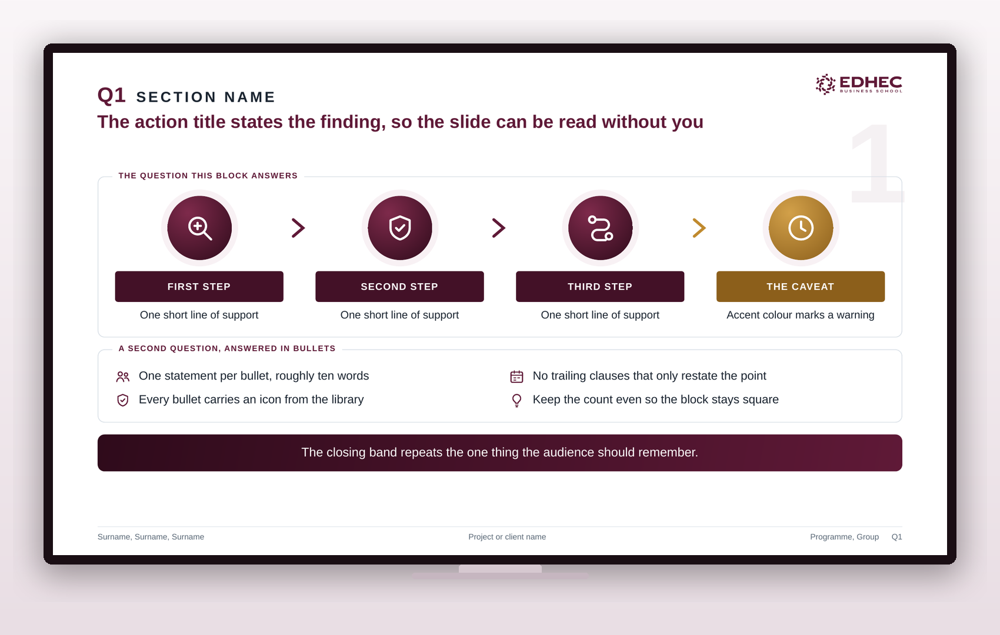

<br><br>

**ENTIRE TEMPLATE**

### Start from it in one command

```bash
gh repo create my-deck --template Sillvs/edhec-project-template --private --clone
```

Open source · MIT licensed · [**See it live →**](https://sillvs.github.io/edhec-project-template/)

<sub>No <code>gh</code>? Click <b>Use this template</b> at the top of this page.</sub>

</div>

---

## The same facts, laid out two ways

<p align="center">
  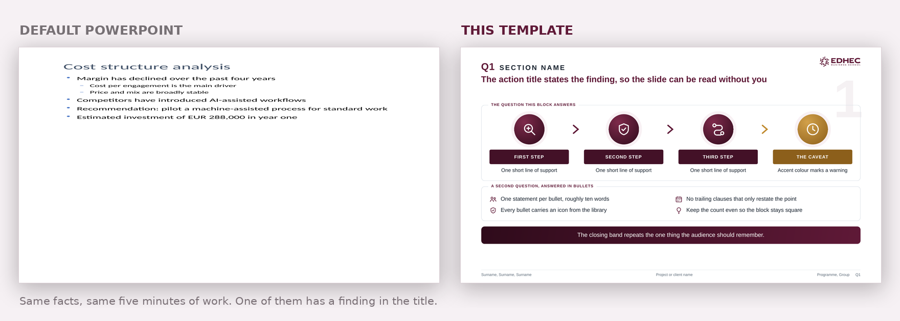
</p>

Both took five minutes. One of them has a finding in the title, a visible
process, and something for the eye to land on. That difference is the entire
repository.

---

## What you get

<table>
<tr>
<td width="33%" valign="top" align="center">

**A deck**

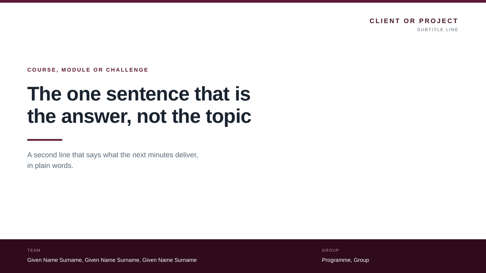

Twelve layout components, thirteen charts, three whole-slide archetypes.

</td>
<td width="33%" valign="top" align="center">

**A paper**

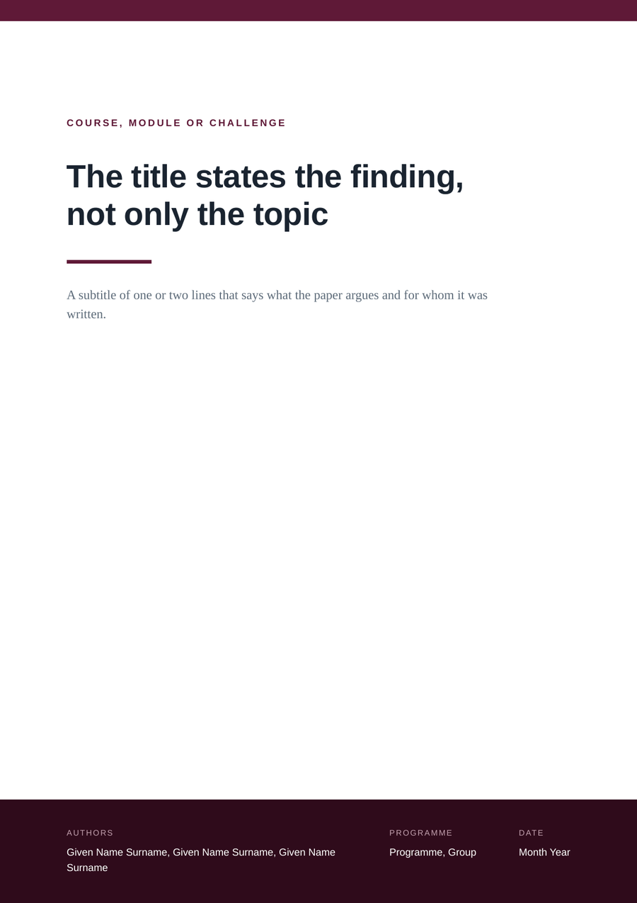

A4, real page numbers, automatic section and figure numbering.

</td>
<td width="33%" valign="top" align="center">

**A one-pager**

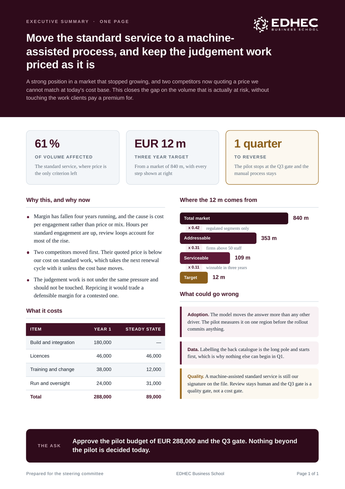

The sheet that stays on the table after you leave the room.

</td>
</tr>
</table>

---

## The part nobody else does

Most HTML slide tools give you a PDF and stop. This one reads the **rendered
geometry straight out of Chrome** and rebuilds every box, every line of text and
every colour as a native PowerPoint shape.

```
slides.pptx: 6 slides, 84 shapes, 116 text boxes, 22 icons
```

Real shapes. Real text. A teammate who has never opened a terminal can drag a
box and fix a typo an hour before the presentation, which is exactly when
somebody always does.

> You also get `slides-pictures.pptx`, one image per slide, pixel-identical to
> the PDF. Use it when the room has an unpredictable projector and you want zero
> surprises.

---

## Charts that make an argument

<p align="center">
  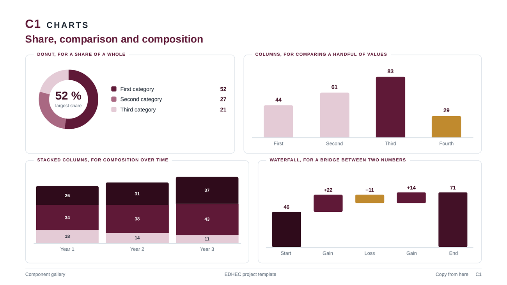
  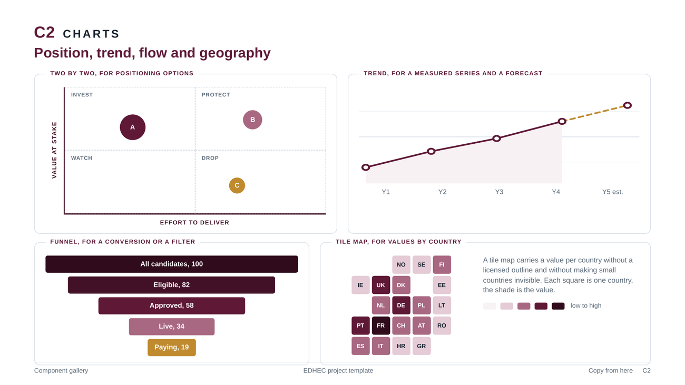
</p>
<p align="center">
  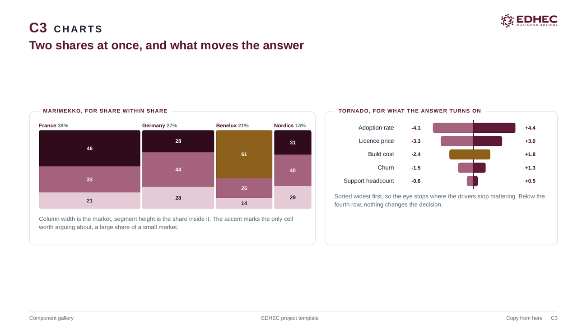
  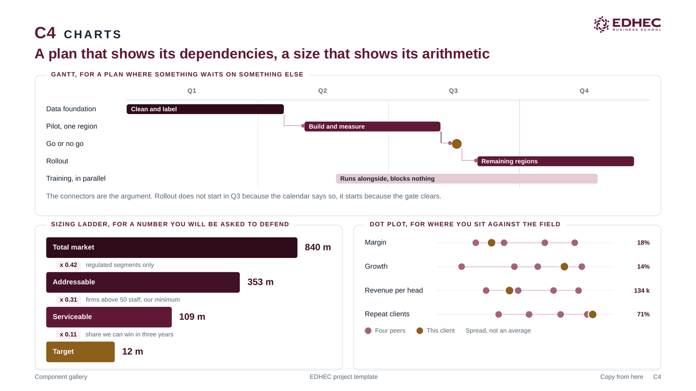
</p>

Donut, columns, stacked columns, waterfall, trend with a forecast, two-by-two,
funnel, tile map, Marimekko, tornado, Gantt with dependencies, sizing ladder and
a peer dot plot.

**No charting library.** Every value is a plain number in the markup, so a chart
can still be corrected during a rehearsal, and it survives the PowerPoint export
as editable shapes rather than a dead picture.

### And whole slides, not just parts

<p align="center">
  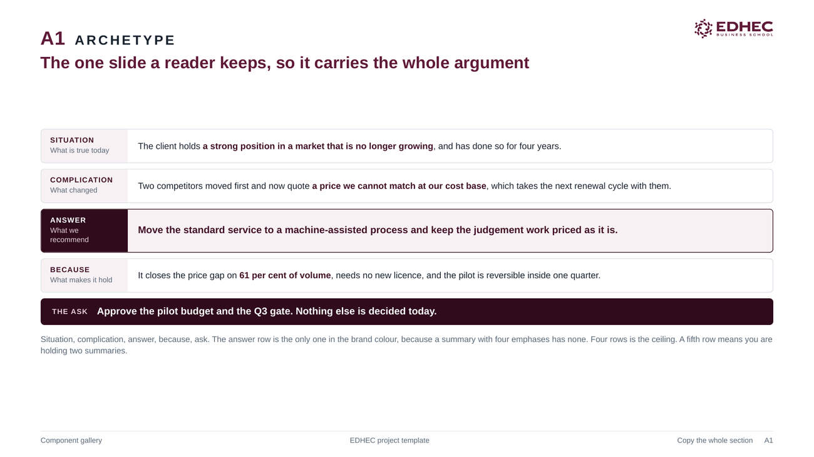
  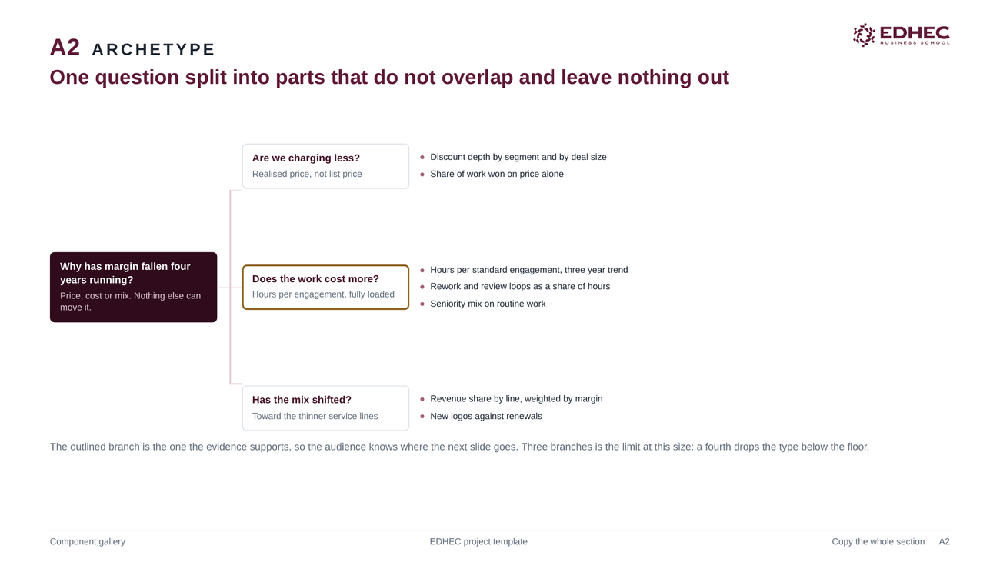
</p>

Executive summary, issue tree and a section divider, built to copy whole.
**[docs/FRAMEWORKS.md](docs/FRAMEWORKS.md)** maps the frameworks you will
actually be asked for — pyramid, MECE, market sizing, Porter, value chain,
business case, prioritisation, competitive position, roadmap — to the components
that carry them, and names how each one usually goes wrong.

---

## Wherever the work ends up

<table>
<tr>
<td width="50%" align="center">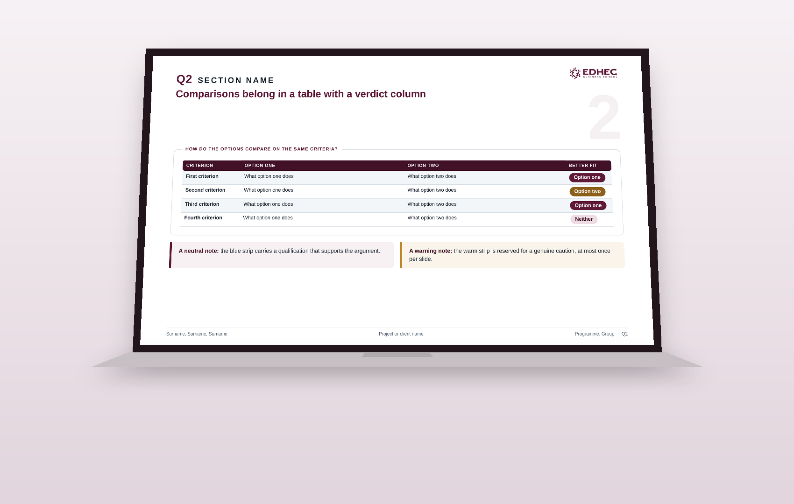<br><sub>A teammate opening it on a laptop</sub></td>
<td width="50%" align="center">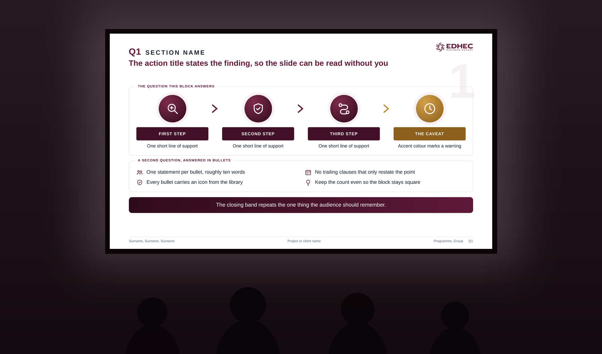<br><sub>Projected, in the room it was made for</sub></td>
</tr>
<tr>
<td align="center">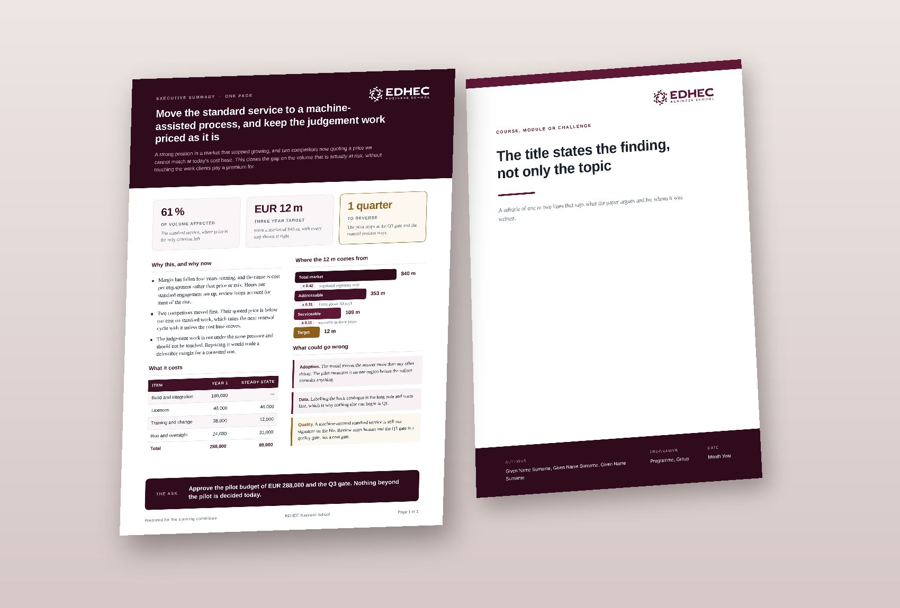<br><sub>The leave-behind, on somebody's desk</sub></td>
<td align="center">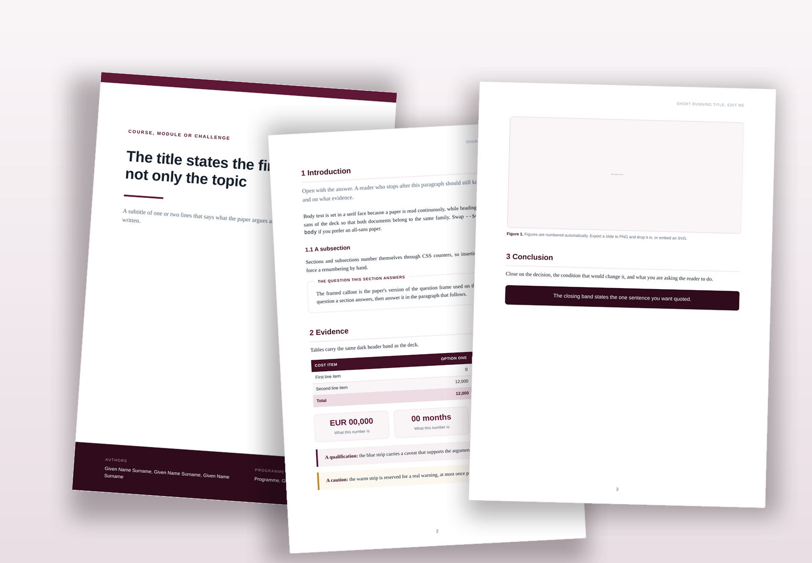<br><sub>Printed, marked up, handed in</sub></td>
</tr>
</table>

Every text-on-colour pairing clears **WCAG AA**, and nothing is set below
11.5px. Not as a box-tick, and not on trust: for the deck, the gallery and the
worked example, `./build.sh` measures every rendered run of text against the
colour actually painted behind it and fails if one falls short. It also fails
on text under the floor, and on anything that overflows the canvas or runs
under the footer, because all three still export and look plausible.

The two paper templates are checked by eye, not by the tool: it reads slide
geometry and a continuous A4 document has none.

A projector in a bright room costs you far more contrast than your laptop
suggests, and the pairing that fails is always the one carrying the number you
came to show.

---

## Start in two minutes

```bash
# 1. author
open slides/slides.html          # edit the HTML in any editor, reload Chrome

# 2. one dependency, only for the PowerPoint export
python3 -m venv .venv && .venv/bin/pip install -r tools/requirements.txt

# 3. everything
PY=.venv/bin/python ./build.sh
```

Out comes `slides.pdf`, `slides.pptx`, `slides-pictures.pptx`, `gallery.pdf`,
`paper.pdf` and `onepager.pdf`.

**Presenting?** Open the deck in Chrome. `→` `←` to move, `F` for full screen,
`O` for the overview grid, `P` to print.

**Looking for a component?** Open `slides/gallery.html`. Everything is there to
copy, with a note on what each one is for.

---

## Why plain HTML

A deck you hand in should still open in five years. This one is four HTML files
and a stylesheet. No framework to go out of date, no `node_modules`, no service
that might not exist by the time somebody wants to reuse your work. The logo is
embedded in every template, so a single file can be mailed and still arrives
with its mark.

The build is only for the PDF and the PowerPoint. Authoring needs nothing but a
browser.

<details>
<summary><b>What the export needs</b></summary>

<br>

| | Why |
|---|---|
| Chromium or Chrome | renders and prints the PDF. Any recent build; `tools/find-chrome.sh` finds it. |
| poppler (`pdfinfo`, `pdftoppm`) | page counts and rasterising |
| Node 22 or newer | the layout extractor, which uses the built-in WebSocket |
| Python with `python-pptx` and `pillow` | the PowerPoint files and the pictures on this page |

No npm install. The pictures in this README are generated by `./build.sh docs`,
so they cannot drift away from the templates.

</details>

<details>
<summary><b>How it is put together</b></summary>

<br>

```
slides/slides.html      the deck. Open in Chrome and start writing.
slides/gallery.html     every component and chart, to copy from.
paper/paper.html        the paper, A4.
paper/onepager.html     the one-page leave-behind.
design/                 tokens, components, the logo.
tools/                  the export toolchain.
docs/                   how to export, what the components are, which framework to use.
examples/               a finished deck from a real course.
build.sh                makes every deliverable.
```

Each template carries its own copy of the stylesheet, so one file is genuinely
one file. That duplication is checked, not hoped for: `./build.sh` fails if the
templates drift apart or if `design/tokens.css` disagrees with them.

</details>

---

## Read next

| | |
|---|---|
| **[docs/EXPORT.md](docs/EXPORT.md)** | How to export, and the traps that silently break the output. Read this before you hand anything in. |
| **[docs/COMPONENTS.md](docs/COMPONENTS.md)** | Every component and chart, the type and spacing scale, and the contrast rules. |
| **[docs/FRAMEWORKS.md](docs/FRAMEWORKS.md)** | Nine consulting frameworks and what to build each one from. |
| **[docs/PAPER.md](docs/PAPER.md)** | Writing a paper in the same design. |
| **[TODO.md](TODO.md)** | Everything that was found, fixed and why, plus what was proposed and deliberately rejected. |

---

## The design

The burgundy `#5F1937` is read out of the official mark in
`design/edhec-logo.svg`. Every other tone is derived from it.

One rule carries most of the look: **burgundy is the voice, the warm gold is a
raised eyebrow.** Use the accent at most once per slide, and only where it means
*careful*. A deck where everything is highlighted highlights nothing.

## Licence

[MIT](LICENSE) for the code, the stylesheets, the templates and the docs.

**The EDHEC mark is not covered.** `design/edhec-logo.svg` is the school's
trademark and is not ours to relicense. A copyright licence does not grant
trademark rights, and MIT does not pretend to. Not at EDHEC? Swap the logo and
the burgundy and everything else is yours. See **[TRADEMARKS.md](TRADEMARKS.md)**
for the two commands that do it.
