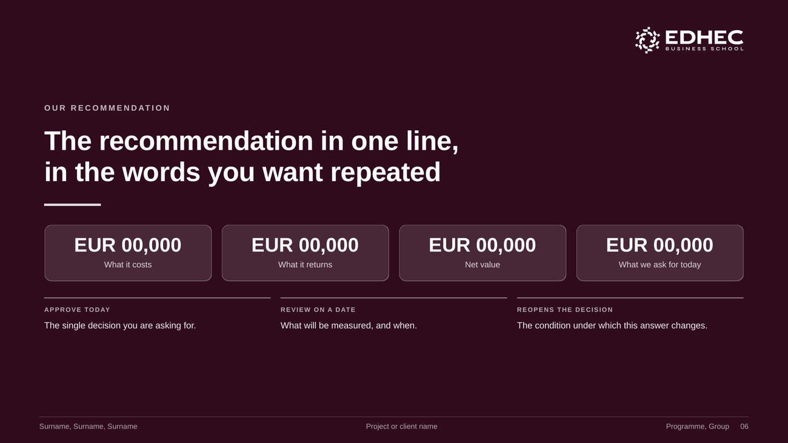
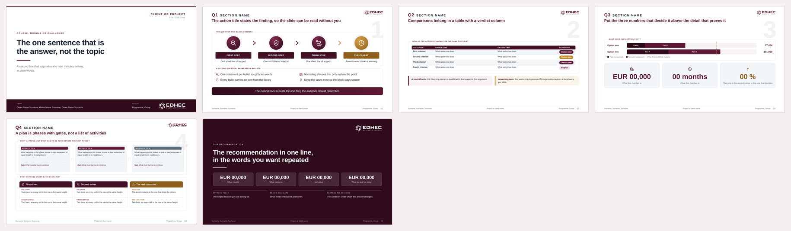

# EDHEC project template

Slide deck and paper in the EDHEC design, plus a toolchain that exports both to
PDF and turns the deck into an **editable** PowerPoint.

<p align="center">
  
</p>

Everything is plain HTML and CSS. No framework, no build step for authoring, no
network dependency: open a file in Chrome and it renders. That is deliberate. A
deck you hand in should still open in five years.

---

## What you get

<table>
<tr>
<td width="50%" valign="top">

**A deck**


</td>
<td width="50%" valign="top">

**that ends on the decision**



</td>
</tr>
</table>

<p align="center">
  
</p>

**And a paper in the same design**, A4, with real page numbers, a running head
and automatic section and figure numbering.

<p align="center">
  
</p>

---

## Charts

A chart library built from the same tokens. Columns, stacked columns, waterfall,
donut, trend with a forecast, two-by-two, funnel and a tile map. No charting
library: every value is a number in the markup, so a chart can still be
corrected during a rehearsal.

<p align="center">
  
</p>
<p align="center">
  
</p>

Open `slides/gallery.html` and copy the markup out of it.

---

## Quick start

```bash
# 1. author
#    open slides/slides.html in Chrome, edit the HTML, reload

# 2. install the one dependency the PowerPoint export needs
python3 -m venv .venv && .venv/bin/pip install -r tools/requirements.txt

# 3. build everything
PY=.venv/bin/python ./build.sh
```

| File | What it is |
|---|---|
| `slides/slides.pdf` | the presentation master, one slide per page |
| `slides/slides.pptx` | **editable** PowerPoint, real shapes and real text |
| `slides/slides-pictures.pptx` | one picture per slide, pixel-identical to the PDF |
| `paper/paper.pdf` | the paper, A4, with page numbers |

`./build.sh slides`, `./build.sh paper` or `./build.sh docs` to build one part.
`docs` regenerates the pictures on this page, so they can never drift away from
the templates.

---

## Layout

```
slides/slides.html      the deck. Open it in Chrome and start writing.
slides/gallery.html     every component and every chart, to copy from.
paper/paper.html        the paper, A4, same design.
design/                 palette, logo, design tokens.
tools/                  the export toolchain.
docs/                   how to export, what the components are, how to write a paper.
examples/               a finished deck from a real course.
build.sh                makes every deliverable.
```

## Presenting

Open `slides/slides.html` in Chrome:

| Key | |
|---|---|
| `→` `←` space | next, previous (clicking the right or left third also works) |
| `F` | full screen |
| `O` | overview grid |
| `P` | print or export to PDF |
| `Home` `End` | first, last slide |

---

## What to read next

- **[docs/EXPORT.md](docs/EXPORT.md)** — how to export, and the six traps that
  silently break the output. Read this before you hand anything in.
- **[docs/COMPONENTS.md](docs/COMPONENTS.md)** — the component and chart
  catalogue: what exists, what each one is for, and the rules that keep a deck
  looking like one deck.
- **[docs/PAPER.md](docs/PAPER.md)** — writing a paper in the same design, and
  how the page numbering works.

## Requirements

| | Why |
|---|---|
| Chromium or Chrome | renders and exports the PDF. Any recent build. |
| poppler (`pdfinfo`, `pdftoppm`) | page counts and rasterising |
| Node 22 or newer | the layout extractor, which uses the built-in WebSocket |
| Python with `python-pptx`, `pillow` | the PowerPoint files and the README images |

Nothing else. No npm install.

## The design

The burgundy `#5F1937` is read out of the official logo in
`design/edhec-logo.svg`. Every other tone is derived from it and listed in
`design/tokens.css`.

One rule carries most of the look: **burgundy is the voice, the warm gold is a
raised eyebrow.** Use the accent at most once per slide, and only where it means
"careful". A deck where everything is highlighted highlights nothing.

## A note on self-contained files

`slides/slides.html`, `slides/gallery.html` and `paper/paper.html` each carry
their own copy of the stylesheet rather than linking `design/tokens.css`. One
file can then be mailed, opened offline and archived on its own, which matters
more for coursework than avoiding duplication. If you change a token, change it
in `design/tokens.css` first, then mirror it into whichever template you use.
